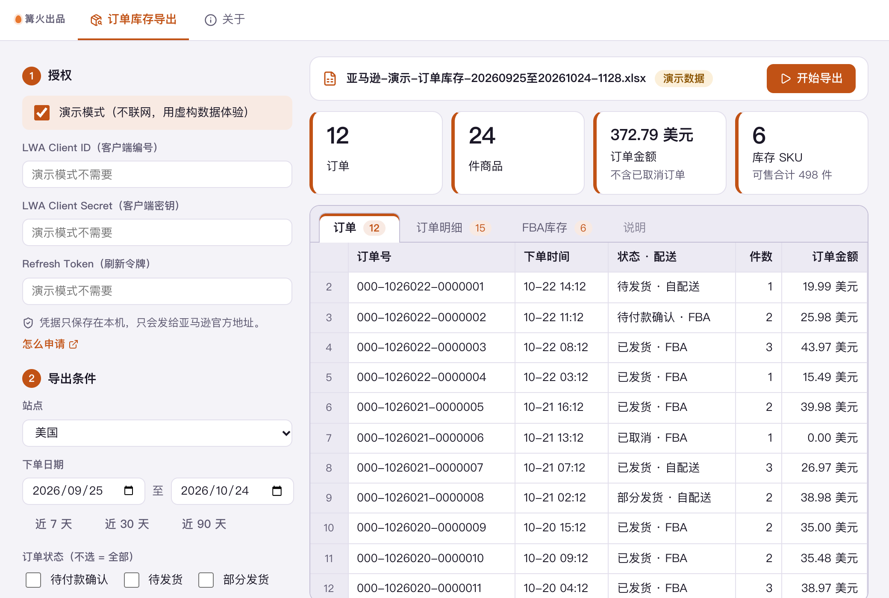

# 亚马逊订单库存导出

> 篝火出品 · 收录于篝火 App 应用区

用你自己的卖家授权，通过亚马逊官方 SP-API 把订单、订单明细和 FBA 库存导出成 Excel。

> 需要卖家自己先申请开发者权限和授权凭据（见下文「先申请什么」）。数据直接在你的电脑和亚马逊官方接口之间传输，不经过任何第三方服务器。



## 下载

到 [Releases](https://github.com/campfire-code/amazon-order-export/releases/latest) 下载对应安装包：

| 电脑 | 文件 |
|---|---|
| Windows 10 / 11 | `amazon-order-export_版本号_windows-x64-setup.exe` |
| Mac（Apple 芯片） | `amazon-order-export_版本号_mac-arm64.dmg` |
| Mac（Intel 芯片） | `amazon-order-export_版本号_mac-x64.dmg` |

第一次打开：
- **Windows**：如果弹出「Windows 已保护你的电脑」，点「更多信息」→「仍要运行」。
- **Mac**：如果提示「无法验证开发者」，打开「系统设置 → 隐私与安全性」，在下方点「仍要打开」。

## 怎么用

### 先申请什么

SP-API 没有「账号密码登录」，必须先有三样东西（申请流程以亚马逊官方文档为准：<https://developer-docs.amazon.com/sp-api/docs/registering-as-a-developer>，页面内容可能调整，本工具未代为核实申请的审核时限与条件）：

1. 在卖家后台注册为开发者，并创建一个**私有应用**（只给自己店铺用）。
2. 应用需要勾选读取订单、读取 FBA 库存对应的角色（未核实具体角色名称，以开发者中心页面为准）。如果没有给应用对应角色，接口会返回 403，工具会提示「没有权限」。
3. 为自己的店铺授权这个应用，得到三项：**LWA Client ID、LWA Client Secret、Refresh Token**。

自 2023-10-02 起 SP-API 不再需要 AWS 账号和 SigV4 签名，工具只用这三项换取访问令牌。

### 导出步骤

1. 打开工具，先勾选「演示模式」体验一遍（不联网，数据为虚构示例，文件名带「演示」）。
2. 取消演示模式，填入三项凭据（只保存在本机应用数据目录的设置文件里，不写日志，不发往亚马逊以外的地址）。
3. 选站点（北美 / 欧洲 / 远东三个区域端点由站点自动决定）、下单日期、订单状态、配送方式（都不选表示全部）。
4. 勾选要导出的内容：订单、订单明细、FBA 库存，点「开始导出」。
5. 完成后文件保存在「下载」文件夹里的「亚马逊订单库存导出」目录，可点「在文件夹中显示」。

### 说明与限制

- 订单用 Orders API 2026-01-01 版的 searchOrders，每页 100 条自动翻页；库存用 FBA Inventory API 的 getInventorySummaries。接口字段、枚举、限速已对照官方模型仓库 amzn/selling-partner-api-models 核实。
- 默认限速：订单接口 0.0056 次/秒（约 3 分钟一次，突发 20）、库存 2 次/秒；工具会按此排队，被限流（429）时自动退避重试，并按响应头里你账户的实际额度调整。订单量大时翻页可能要等几分钟，属于亚马逊的限制。
- 不请求买家姓名、地址等个人信息（只请求金额和配送信息）。
- 订单金额合计不含已取消订单，取自接口返回的订单总额；不同币种分开合计。
- 单次只导出一个站点；多站点请分别导出。
- 本工具的测试使用按官方模型编写的模拟响应，没有用真实店铺验证过，**真实店铺下的表现未核实**。
- 未请求退款、费用、结算等数据，也未做 Excel 之外的格式。


## 验收用例

无需真实店铺，全部用演示模式完成（`samples/README.txt` 说明了演示数据）：

1. 打开工具，勾选「演示模式」，保持默认站点「美国（US）」，点「近 30 天」，三项内容全选，点「开始导出」。
   应得到：右侧显示 12 订单、24 件、372.79 美元（不含已取消）、6 个库存 SKU；订单分两页拉取。
2. 打开生成的 `亚马逊-演示-订单库存-…xlsx`。应有工作表：订单（12 行）、订单明细、FBA库存（6 行）、说明；首行加粗并冻结。
3. 订单状态只勾「已发货」，再导出。应只包含已发货的订单。
4. 取消演示模式、不填凭据点「开始导出」。应提示「请先填写 Client ID、Client Secret 和 Refresh Token」，不发出任何请求。
5. 自动化验收：`pnpm test`，32 个用例覆盖参数、解析、翻页、限流重试、401/403/授权失效、停止、Excel 读回。
6. 真实店铺验收（需要你自己的凭据，作者未做）：用近 7 天范围导出，对照卖家后台订单管理的订单数。


## 自己编译

需要 Node.js 22、pnpm、Rust。

```bash
pnpm install
pnpm test          # 单元测试
pnpm tauri dev     # 开发运行
pnpm tauri build   # 打包
```

界面框架在 `src/kit`（所有 campfire-code 工具共用），本工具的逻辑在 `src/tool`。

## 致谢

本工具为自研实现（TypeScript），接口与字段以亚马逊官方文档和 [amzn/selling-partner-api-models](https://github.com/amzn/selling-partner-api-models)（Apache-2.0）为准；参考了 [saleweaver/python-amazon-sp-api](https://github.com/saleweaver/python-amazon-sp-api)（MIT）的思路，未复制其代码。

## 归属

本工具由**篝火**出品，是篝火 App 应用区收录的开源工具之一，由篝火（GitHub 组织 [campfire-code](https://github.com/campfire-code)）维护与更新。全部工具的目录见 [toolkit-hub](https://github.com/campfire-code/toolkit-hub)。

## 许可证

MIT，版权方为篝火（campfire-code）。
